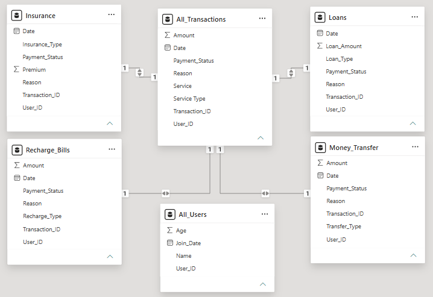
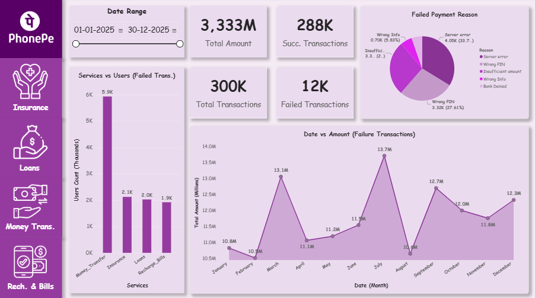
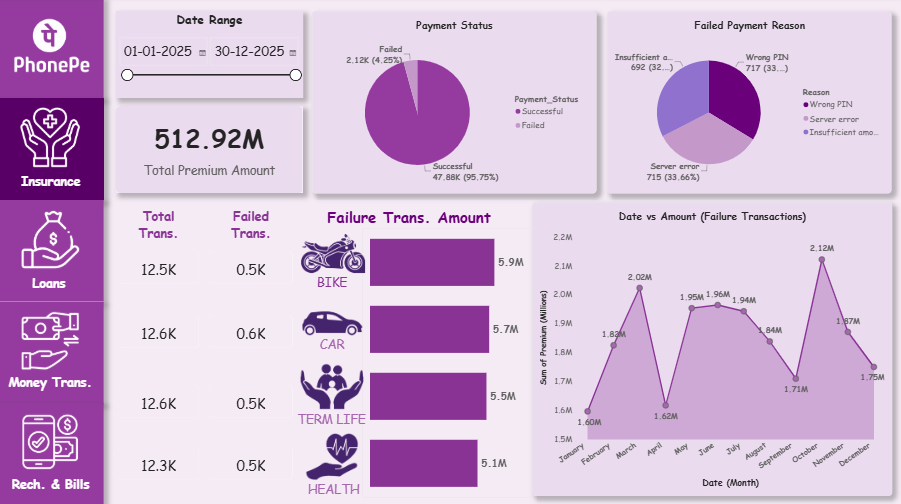
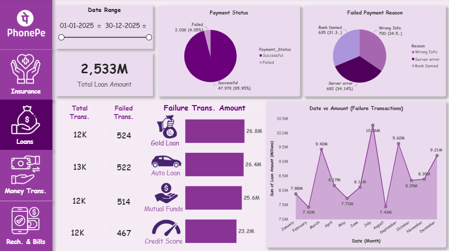
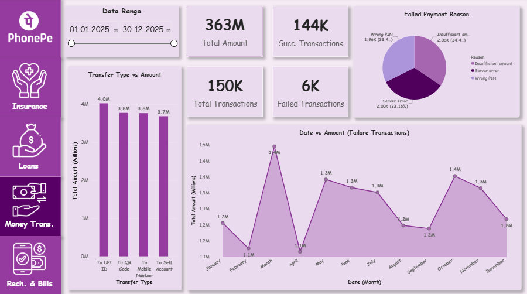
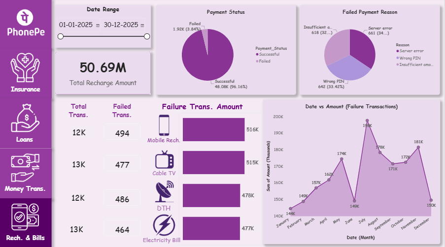

# <a href="https://yaswanth123455.github.io/PhonePe_Dashboard/" target="_blank">PhonePe_Dashboard
## *Click the link above to open the fully interactive Power BI dashboard, where you can click filters, slicers, and explore the live metrics.*

### 📌 Project Overview

The PhonePe Data Analysis Project is a 5-page interactive Power BI dashboard designed to analyze transaction activity and financial services across the PhonePe platform.

The dashboard provides a consolidated overview of transaction performance and dedicated analysis for: 
🏠 Home - Overall Overview 
🛡️ Insurance 
🏦 Loans 
💸 Money Transfer 
📱 Recharge & Bills 

The project focuses on understanding transaction volumes, transaction amounts, payment statuses, service categories, monthly trends, and failed-payment reasons through an interactive reporting experience.

### 🎯 Business Problem

Digital payment platforms generate large volumes of transactions across multiple financial services. Analyzing these transactions independently can make it difficult to understand overall performance and identify areas requiring attention.

This project addresses the need for a centralized dashboard that allows users to:

- Monitor total transaction amounts 
- Track successful and failed payments 
- Analyze transaction trends over time 
- Compare different financial services 
- Understand service-specific transaction behavior 
- Identify reasons behind failed transactions 
- Analyze transaction activity using different date ranges 
- Navigate between different service areas from a single dashboard

The dashboard converts raw transaction data into an interactive analytical experience for exploring business performance.

### 📊 Key KPIs

<b>Walkthrough of Key Visuals & Business Insights</b>
- <b>💰 Transaction Scale:</b> The dashboard tracks <b>₹3.33B total transaction amount</b> across <b>300K transactions</b>, providing a consolidated view of PhonePe activity across Insurance, Loans, Money Transfer, and Recharge & Bills.
- <b>✅ Payment Performance:</b> Out of <b>300K transactions, 288K were successful and 12K failed</b>, representing approximately 96% successful transactions and <b>4% failed transactions</b>.
- <b>💸 Service-wise Activity: Money Transfer accounts for 150K transactions </b>, while Insurance, Loans, and Recharge & Bills each contribute around <b>50K transactions</b>, enabling comparison of transaction activity across services.
- <b>⚠️ Failure Analysis:</b> The dashboard tracks <b>12K failed transactions</b> and breaks them down by reasons such as <b>Server Error, Wrong PIN, Insufficient Amount, Wrong Information, and Bank Denied</b>, helping identify common payment failure patterns.
- <b>📅 Trend & Decision Support:</b> Monthly transaction-value charts and service-level KPIs allow users to analyze performance throughout <b>2025</b>, compare services, identify transaction trends, and explore areas requiring further attention.

### 🛠️ Tech Stack

| Technology      | Purpose                                                            |
| --------------- | ------------------------------------------------------------------ |
| **Power BI**    | Dashboard development, data modeling and interactive visualization |
| **Power Query** | Query	Data cleaning, transformation and data preparation           |
| **Excel**       | Source dataset and unstructured transaction data                   |

### 🏗️ Data Architecture

| Table                | Description                                                        |
| -------------------- | ------------------------------------------------------------------ |
| **All_Users**        | User master information including User ID, name, age and join date |
| **All_Transactions** | Consolidated transaction-level information                         |
| **Insurance**        | Insurance transaction related details                              |
| **Loans**            | Loan transaction related details                                   |
| **Money_Transfer**   | Money transfer related transaction details                         |
| **Recharge_Bills**   | Recharge and bill payment related transactions                     |

#### Data Model
The relationships connect the transaction and user information to provide a unified analytical view across PhonePe's different financial services. 

### 📸 Snapshots

<b>🏠 Summary Page</b>
- ₹3.33B total transaction amount across the PhonePe services, with 300K total transactions.
- 288K successful transactions are tracked against 12K failed transactions, with failure reasons such as server errors, wrong PIN, insufficient amount, and wrong information.
- Money Transfer has the highest number of users among the services, followed by Insurance, Loans, and Recharge & Bills.

<b>🛡️ Insurance Page</b>
- ₹512.92M total premium amount is recorded across insurance transactions.
- The report tracks 47.88K successful transactions and 2.12K failed transactions, with failure reasons including Wrong PIN, Server Error, and Insufficient Amount.
- Bike, Car, Term Life, and Health Insurance are compared by transaction amount, while monthly trends show changes in premium amounts throughout 2025.

<b>🏦 Loans Page</b>
- ₹2.533B total loan amount is represented across the loan transactions.
- The report records 47.97K successful transactions and 2.03K failed transactions, with failures categorized by Wrong Info, Server Error, and Bank Denied.
- Gold Loan, Auto Loan, Mutual Funds, and Credit Score are compared by transaction amount, with monthly loan-value trends visualized throughout the year.

<b>💸 Money Transfer Page</b>
- The report covers ₹363M in total transfer amount across 150K transactions.
- 144K successful transactions and 6K failed transactions are analyzed, with failure reasons including Insufficient Amount, Server Error, and Wrong PIN.
- Transfer activity is compared across UPI to ID, UPI to QRs, Mobile to Mobile, and Self Account, alongside monthly transaction-value trends.

<b>📱 Recharge & Bills Page</b>
- ₹50.69M total recharge amount is analyzed across recharge and bill-payment transactions.
- The report records 48.08K successful transactions and 1.92K failed transactions, with failures categorized by Server Error, Wrong PIN, and Insufficient Amount.
- Mobile Recharge, Cable TV, DTH, and Electricity Bill transactions are compared by amount, with monthly trends showing changes throughout 2025.

### 🚀 Live Dashboard

View Live: <b><a href="https://yaswanth123455.github.io/PhonePe_Dashboard/" target="_blank">PhonePe Analytics Dashboard</a></b>  
The live dashboard provides an interactive experience where users can explore transaction performance using:
1. Interactive slicers
2. Service-level filtering
3. Date-based analysis
4. Transaction-status filtering
5. KPI cards
6. Interactive charts and visualizations
